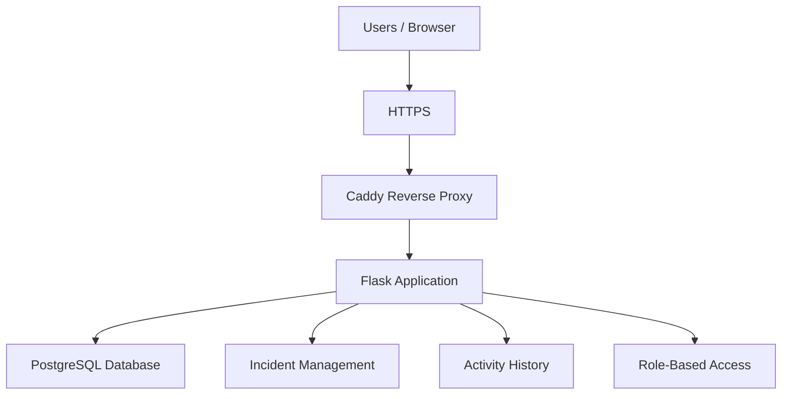
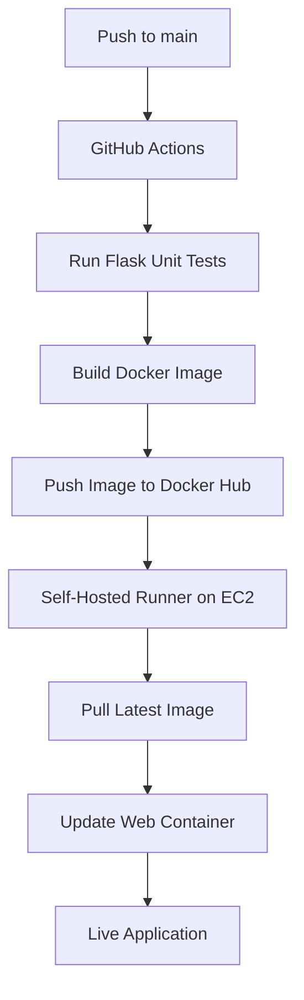

# IncidentFlow – IT Incident Management & Operations Platform

IncidentFlow is a web-based IT Incident Management platform designed to help teams record, track, assign, and resolve IT incidents through a centralized dashboard.

The project demonstrates full-stack application development, containerization, CI/CD automation, cloud deployment, and production database management.

**Live Application:** https://incidentflow-yesh.duckdns.org  
**GitHub Repository:** https://github.com/yeshwanth15-V/incidentflow  
**Docker Hub:** https://hub.docker.com/r/yesh1520/incidentflow

---

## Features

- **Incident Management:** Create, view, update, assign, and track IT incidents.
- **Dashboard:** Monitor incidents through a centralized dashboard and visual summaries.
- **Role-Based Access Control:** Admin and Support Agent roles.
- **Activity History:** Track incident-related actions and changes.
- **SLA Management:** Track incident deadlines.
- **Database Persistence:** Store application data in PostgreSQL.
- **REST API:** Support incident-related API operations.
- **Email Notifications:** Optional SMTP-based notification configuration.
- **Responsive Interface:** Modern web interface for incident operations.

## Technology Stack

| Category | Technologies |
|---|---|
| Backend | Python, Flask |
| Frontend | HTML, CSS, JavaScript |
| Database | PostgreSQL 16 |
| ORM | Flask-SQLAlchemy |
| Application Server | Gunicorn |
| Containerization | Docker, Docker Compose |
| CI/CD | GitHub Actions |
| Container Registry | Docker Hub |
| Cloud | AWS EC2 |
| Reverse Proxy | Caddy |
| HTTPS | Let's Encrypt |
| Operating System | Ubuntu 24.04 |

## System Architecture



## CI/CD Pipeline

IncidentFlow uses GitHub Actions to automate testing, Docker image publishing, and deployment.



### Pipeline Stages

1. **Testing:** Install Python dependencies and run unit tests.
2. **Build and Publish:** Build the Docker image and publish it to Docker Hub.
3. **Deployment:** Use a self-hosted GitHub Actions runner on AWS EC2 to pull and deploy the latest image.

The deployment job runs only after the test and image publishing jobs succeed on pushes to the `main` branch.

## Cloud Deployment

The application is deployed on an AWS EC2 Ubuntu server.

Production services:

| Service | Purpose |
|---|---|
| Flask + Gunicorn | Application hosting |
| PostgreSQL | Persistent database |
| Caddy | Reverse proxy and HTTPS |
| Docker Compose | Container orchestration |
| GitHub Actions Runner | Automated deployment |

### HTTPS Configuration

Caddy handles incoming HTTP/HTTPS traffic and reverse-proxies requests to the Flask application. HTTPS certificates are provisioned and renewed automatically through Let's Encrypt.

**Live URL:** https://incidentflow-yesh.duckdns.org

## Database Backup

Production PostgreSQL backups are generated using `pg_dump`.

Example:

```bash
docker compose exec -T db sh -c \
'pg_dump -U "$POSTGRES_USER" "$POSTGRES_DB"' \
> incidentflow-backup.sql
```

Keep backups and environment files private. Never commit `.env`, database credentials, or sensitive backup data to GitHub.

## Local Development

### Prerequisites

- Python 3.12+
- Docker Engine
- Docker Compose
- Git

### Clone the repository

```bash
git clone https://github.com/yeshwanth15-V/incidentflow.git
cd incidentflow
```

### Configure environment

Create a local `.env` file with the required database connection, application secret, and configuration values. Use your own secure credentials and never publish this file.

### Run with Docker Compose

```bash
docker compose up -d --build
```

Check service status:

```bash
docker compose ps
```

View application logs:

```bash
docker compose logs -f web
```

## Repository Structure

```text
incident-management-system/
├── .github/
│   └── workflows/
│       └── ci.yml
├── app.py
├── config.py
├── requirements.txt
├── Dockerfile
├── compose.yaml
├── tests/
├── templates/
├── static/
├── migrations/
├── README.md
└── .gitignore
```

*The structure above illustrates the main project components; individual files and directories may vary.*

## Project Verification

The following deployment milestones were verified:

- Flask unit tests: 14 passed.
- Docker image successfully published to Docker Hub.
- GitHub Actions: all three pipeline stages completed successfully.
- AWS EC2 deployment: successful.
- PostgreSQL: healthy in production.
- HTTPS: working through Caddy and Let's Encrypt.
- Self-hosted GitHub Actions runner: active.
- Production database backup: generated and inspected.
- Production database: incident, activity history, and user tables verified.

## Future Improvements

- Automated scheduled database backups.
- Off-site backup storage.
- Application monitoring and alerting.
- Enhanced deployment rollback strategy.
- Additional automated integration tests.

## Author

**Yeshwanth V**

B.Tech Information Technology

- GitHub: https://github.com/yeshwanth15-V
- LinkedIn: https://linkedin.com/in/yeshwanthv1/

---

*IncidentFlow – Built to demonstrate practical application development and DevOps automation.*
